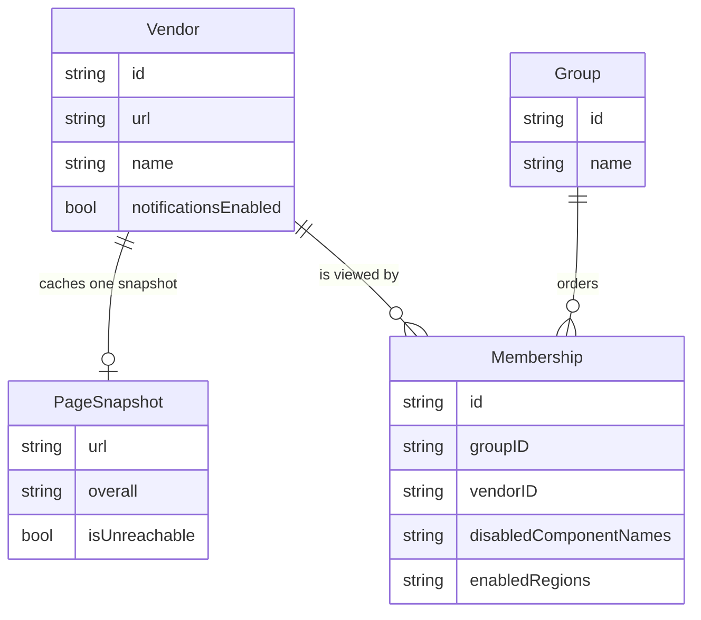
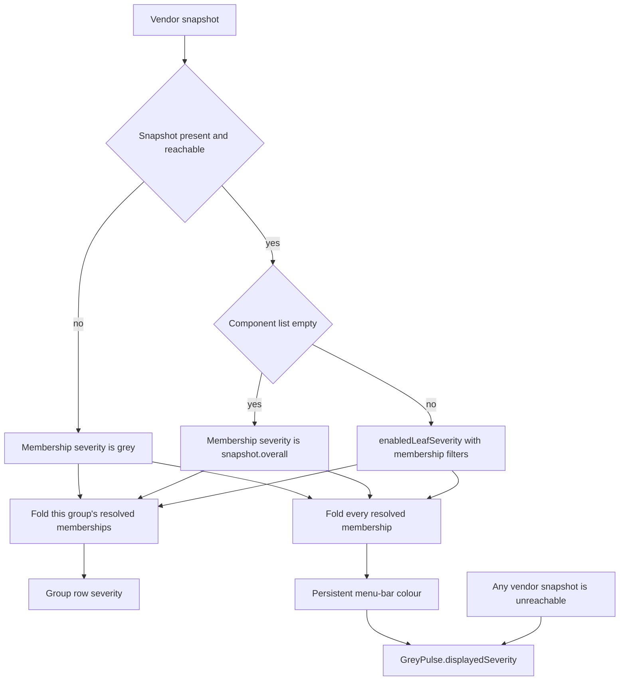

# Groups of vendors

| Field | Value |
| --- | --- |
| Title | Groups of vendors |
| Author | Terry Gerighty |
| Date | 2026-09-25 |
| Status | Draft, revised after review |
| Product | greendot, a local macOS menu-bar app for one person |

## Overview

greendot must let one person put vendors into groups. A vendor is one watched status page. A group is an ordered list of memberships. The same vendor can be in more than one group. Each membership stores its own component edits. The group status is the worst status of its members.

The app watches about 50 pages. It polls every 60 seconds. There is no server. There is no multi-user sync. There is no feature-flag service.

This document specifies the model, the menu, the windows, and the pull-request split. It does not change product code.

## Background & Motivation

Today the menu is a flat list. `MenuBuilder.pageItem` in `Sources/greendot/MenuBuilder.swift` builds one row per `WatchedPage`. The row title is `page.name`. The row dot is `page.displaySeverity`.

`WatchedPage` in `Sources/StatusCore/Models.swift` stores the page and the view together. The stored fields are `id`, `url`, `name`, `notificationsEnabled`, `disabledComponentNames`, `enabledRegions`, and `snapshot`. One page can have only one mute list and one region list. A second view of the same URL is not possible.

`WatchedPage.displaySeverity` uses these rules:

- A missing snapshot is grey.
- `snapshot.isUnreachable` is grey.
- An empty component list returns `snapshot.overall`.
- Otherwise it calls `ComponentTree.enabledLeafSeverity` with that page's `disabledComponentNames` and `enabledRegions`.

`enabledRegions` has three meanings. `nil` means the mute list only. An empty list mutes every component. A non-empty list counts a component when its name or id contains a token, and children of a match count too. `RegionFilter.allows` in `Sources/StatusCore/ComponentTree.swift` implements that match. `nil` regions mean no filter. An empty region list matches nothing.

`ComponentTree.enabledLeafSeverity` returns green when no enabled leaf is present.

`Severity` in `Sources/StatusCore/Severity.swift` has the cases `red`, `yellow`, `green`, and `grey`. The display names are Major outage, Degraded, Operational, and Unreachable. `Aggregator.fromSeverities` returns red if any input is red, else yellow if any is yellow, else green if any is green, else grey if any is grey, else green. Green plus grey is green. Only grey is grey. An empty list is green.

The menu-bar icon uses `Monitor.displayedSeverity` in `Sources/StatusCore/Monitor+Presentation.swift`. It folds `page.displaySeverity` with `Aggregator.fromSeverities`. It then calls `GreyPulse.displayedSeverity`. `GreyPulse` flashes grey for 1 second every 30 seconds when any page snapshot is unreachable and the persistent colour is not already grey.

Add and Edit are the `StatusPageEditor` panel. Save probes the URL, then calls `monitor.edit`. Menu Remove is not a window. `onRemove` in `Sources/greendot/AppDelegate.swift` calls `monitor.remove` immediately and clears that page toast. The editor Remove button in `PagePanelController.removeTapped` also deletes immediately. `ComponentPicker` keeps `regionTokens` and disabled names in memory. `selectedEnabledRegions` and `selectedDisabledNames` are read when the window saves. Clicks do not write config. `handleStoreError` reloads a disk change only while `editor == nil`. There is no changed-config dialog. A second `openEditor` closes the first panel.

Notifications are per page. `mergePollResults` loops once per page. It reads `page.displaySeverity` before it replaces the snapshot, then calls `pollToast`. `pollToast` passes those display values to `ToastPolicy.toast` as `overall`. One sound plays when a page leaves green. One sound plays when it returns to green. A colour change while unhealthy sets `Toast.silent` and rewrites the notification with no sound. `refreshToast` in `AppDelegate.swift` builds a `Toast` with `silent` left false, so an editor refresh beeps. `reconcileToasts` in `AppDelegate+Config.swift` compares `displaySeverity` again. Filters change `displaySeverity`, so they change whether a toast fires. A poll fetches one URL per watched page.

`monitor.edit` writes the shared name, the URL, and the page filter fields. `if let enabledRegions` cannot store `nil`. `toggleComponent` and `setAllComponents` write `disabledComponentNames` for a page id. They are test entry points, not menu actions. `commitWatchedPageMutation(invalidatingBodyFor:)` bumps `pageInputRevisions` and clears `lastBodies` so an in-flight poll cannot apply a second snapshot.

`maybeSeedOpenAI` calls `monitor.add` when the page list is empty.

Config is version 2. `AppConfig.currentVersion` is 2. `PageStore` encodes JSON with pretty-printed sorted keys. `AppConfig.encode` writes `version`, `pollSeconds`, and `pages` only. It does not write `didSetLaunchAtLogin`. `WatchedPage.encode` does not write `snapshot`. Snapshots live in `state.json`, keyed by page id. A cached snapshot is used only when its URL matches the page URL. `pollAll` calls `PageStore.save` when the in-memory config is not equal. Equality includes `snapshot`. `writeIfChanged` then skips `config.json` when the encoded bytes match.

`ProviderProbe.persistedPageURL` strips the fragment and adds `https` when the scheme is missing. It keeps the query and the path, including a trailing slash.

The person needs more than one view of the same vendor. Those views must not poll the URL twice.

## Goals & Non-Goals

### Goals

- A person can create groups and put vendors in them.
- One vendor has one id, one URL, one poll, and one snapshot.
- One vendor can have memberships in several groups.
- Each membership has its own `disabledComponentNames` and `enabledRegions`.
- Group severity is `Aggregator.fromSeverities` of that group's membership severities.
- A vendor that has no membership in a named group appears in the Ungrouped section.
- A legacy version-2 file with pages and no `groups` key still loads.
- Load does not rewrite that file. A later poll does not rewrite it either.
- Notifications stay on the vendor.
- The icon, the toasts, and the menu use one membership resolver.
- The first code pull requests do not change parsers or `RegionFilter` match rules.

### Non-Goals

- Nested groups are out of scope.
- New status-page parsers are out of scope.
- Changes to `RegionFilter` match rules are out of scope.
- A server is out of scope.
- Sharing config between people is out of scope.
- Multi-user sync is out of scope.
- A feature-flag service is out of scope.
- Drag-and-drop reorder is out of scope for these pull requests.

Menu order is still array order. The model stores that order. These pull requests do not add a drag UI.

## Proposed Design

### Terms

Vendor means one watched status page. The end-state `Vendor` type stores `id`, `url`, `name`, and `notificationsEnabled`. The name is the shared poll name. The vendor stores the snapshot in memory only. The vendor does not store `disabledComponentNames` or `enabledRegions`.

Until pull request 3 deletes it, the Swift type remains `WatchedPage`. In pull request 2 a vendor with one resolved membership has one filter value. The membership is that value. The same mutation copies it onto `WatchedPage.disabledComponentNames` and `WatchedPage.enabledRegions`. `WatchedPage.displaySeverity` and `enabledComponents` read that membership. The page fields are the same filters, kept for the legacy encoder and for `ComponentPicker`. They must not be written on their own. Pull request 3 deletes the page fields. It is named in the PR Plan.

Group means `id`, `name`, and an ordered list of memberships.

Membership means `id`, `groupID`, `vendorID`, and that group's view. The view is `disabledComponentNames` and `enabledRegions`. Two memberships of one vendor do not share those values. Editing components in one group does not change the other group.

The catch-all is the group whose id is `Group.ungroupedID`. That id is `00000000-0000-4000-8000-000000000001`. Its name is always `Ungrouped`. The id is the identity. The name is not. The menu section lists the memberships of this one group. It does not collect vendors by title.

### Resolved memberships

`AppConfig.resolvedMemberships()` is the only list the menu, the icon, and the toasts may fold.

The list contains every stored membership. For each vendor that has no stored membership, it also contains one in-memory catch-all membership. That orphan membership is held in `orphanMemberships`, which is not encoded. Its id is chosen once per load and stays stable for the session. Its `groupID` is `Group.ungroupedID`. Its filters are the filter fields loaded from that page, when the page had any. Otherwise the mute list is empty and `enabledRegions` is `nil`.

An orphan is included in `persistentBarSeverity` and `vendorNotificationSeverity` for the whole session. It is not only drawn in the menu. A poll must not write it into `groups`. Every change to an orphan calls `recordOrphanEdit` before the config is saved. The next save that materializes groups copies each live orphan, after that update, onto the stored catch-all and clears `orphanMemberships`. It does not copy the filters from the original decode.

`vendorNotificationSeverity` of a vendor with no resolved membership cannot occur. The resolver always adds the orphan first. `Aggregator.fromSeverities([])` is therefore not the vendor result.

`remove` deletes the vendor and every membership whose `vendorID` is that vendor. It does not leave a membership with no vendor.

### Data model



`PageSnapshot` stays in `state.json`. It is not written into `config.json`. The snapshot key is the vendor id. This is the same key `PageStore.applyState` uses today.

A membership does not own a snapshot. Every membership of a vendor reads that vendor's snapshot.

`enabledRegions` keeps today's three meanings on the membership. `nil` is the mute list only. An empty array mutes every component. A non-empty array is the region token list.

The same vendor must not have two memberships in one group. Load keeps the first membership and drops the later ones. It does not merge the dropped filters. The same vendor may have one membership in each of several groups.

### Membership severity

Membership severity uses the `WatchedPage.displaySeverity` rules on the shared snapshot and that membership's filters.

The checks stay in this order:

1. A missing snapshot returns grey.
2. `snapshot.isUnreachable` returns grey.
3. An empty `snapshot.components` list returns `snapshot.overall`.
4. Otherwise return `ComponentTree.enabledLeafSeverity` with the membership's `disabledComponentNames` and `enabledRegions`.

Step 2 happens before the filters. An unreachable vendor is grey in every membership. Filters cannot turn an unreachable vendor green in one group and red in another.

`ComponentTree.enabledLeafSeverity` still returns green when no enabled leaf is present. A membership that mutes every component of a reachable page with components is green. That matches today's page rule.

The implementation must live in one function. `Membership.displaySeverity(of:)` owns the rules. Call sites must not copy the branch order.

### Group severity

Group severity is `Aggregator.fromSeverities` of that group's resolved membership severities. `Aggregator` is not changed.

The fold is:

- Any red membership makes the group red.
- Otherwise any yellow membership makes the group yellow.
- Otherwise any green membership makes the group green.
- Otherwise any grey membership makes the group grey.
- A group with no memberships is green.

Grey rule: an unreachable member does not turn the group red or yellow, and does not turn a green group grey. A group whose members are all grey is grey. Green plus grey is green. Yellow plus grey is yellow. Red plus grey is red.

An empty named group is shown in the menu as green. It has no members, so the empty fold applies. An empty group is not the same as a group whose members are all grey.

### Menu-bar severity



The group row uses `groupFold` for that group only. The persistent menu-bar colour uses `barFold`. `barFold` is `Aggregator.fromSeverities` of `resolvedMemberships()`. That includes orphan catch-all memberships. It does not include an empty group, because an empty group has no membership. An empty green group must not paint the icon green over an all-grey vendor list.

Do not feed a group-row colour into the icon. Do not feed the icon fold back into a group row.

`GreyPulse` stays as it is. `Monitor.displayedSeverity` calls it only after `barFold`. `hasUnreachable` is true when any vendor snapshot has `isUnreachable == true`. Filters do not clear that flag. A member that is unreachable still makes the menu-bar icon flash grey when the persistent colour is not already grey. When every resolved membership is grey, the persistent colour is grey, and `GreyPulse` stays grey.

Pull request 1 must not switch the icon. Pull request 2 switches it in the same change that makes `add`, `edit`, and `remove` update memberships.

### Notifications

Notifications stay on the vendor. They are not stored on the membership. They are not stored on the group. `notificationsEnabled` remains one Boolean on the vendor.

One vendor in three groups produces one unhealthy period, not three. The app must not also notify per group. Every vendor toast uses the vendor id as `Toast.pageID`.

The toast severity is `vendorNotificationSeverity`. Compute it from `resolvedMemberships()` and the snapshot under test. A filter set that makes every membership green does not notify. A filter set that makes one membership red does notify. The worst membership wins.

The toast body is the severity display name, then the names of the groups whose membership severity equals that winning severity. Stored groups use `groups` array order. Example: `Major outage — Work`. A tie lists each winning group. One toast still carries that body. The person does not have to open the menu to see which membership won. `Unreachable` keeps that word and then the same group names. An orphan has `groupID == Group.ungroupedID` and is not in `groups` while the catch-all is omitted. Print `Group.ungroupedName` for that membership. Do the same when the winning membership's group id is the catch-all and that group is not stored. The body is then `Major outage — Ungrouped`. It is not a bare `Major outage`.

These producers all use that severity and that body:

- `pollToast` computes the previous severity before `mergePollResults` replaces the snapshot. It computes the current severity after the replacement. The two calls see different snapshots. It passes those values to `ToastPolicy.toast`. There is one toast per vendor per poll.
- `StatusPageEditor.save` compares the previous and current vendor severities. Green clears the vendor toast. A change that stays non-green refreshes with `Toast.silent == true`. A change that leaves green delivers a toast that is not silent. Do not call today's `refreshToast`, which leaves `silent` false and beeps.
- `refreshToast` takes the previous vendor severity. It sets `silent` when both severities are non-green. Callers that do not know the previous severity must not use it for a colour change.
- `reconcileToasts` compares vendor notification severity and vendor name. It clears the toast when the vendor is gone, notifications are off, the snapshot is missing, or the severity is green. It refreshes when the colour or the name changes and the vendor stays unhealthy. That refresh uses the silent rule.
- Remove membership clears the vendor toast only when the vendor is deleted or the new vendor severity is green. If the vendor remains non-green in another group, the toast stays. A severity change while it stays non-green rewrites it with `silent == true`.
- `toggleNotifications` still clears the vendor toast when notifications turn off.
- `NetworkToast.apply` receives one entry per vendor. `stillNotGreen` uses `vendorNotificationSeverity != .green` and `notificationsEnabled`. `pageToast` uses that severity and the vendor id. It must not build one toast per membership. `allUnreachable` still counts vendors. One URL in three groups is one page.

`ToastPolicy.toast` can keep its silent rule. Callers must pass the vendor severities, not one membership severity per group.

A filter edit that probes uses the probed snapshot and the saved filters for that one vendor decision. The editor path uses the silent rule above. It does not beep when the vendor was already unhealthy.

Every new mutation runs through `commitWatchedPageMutation`. A change to a vendor snapshot, a vendor URL, or that vendor's membership filters passes `invalidatingBodyFor` that vendor id. That bumps `pageInputRevisions` and clears `lastBodies`. An in-flight poll then cannot apply a stale snapshot and emit a second toast. `add`, `editVendor`, `editMembership`, `remove`, `removeMembership`, `removeGroup`, `toggleComponent`, and `setAllComponents` all do this when they touch that vendor.

Pull request 2 includes a test that one vendor in three groups emits one toast and one beep when the aggregate leaves green, and no beep when it stays non-green.

### Menu

Named groups are rows in `groups` array order, except the catch-all. The row shows the group name and the group severity dot. The group row does not open a URL. A group has no single URL.

The group submenu lists each member in membership array order. Each member row shows the vendor name and that membership's severity. Clicking the vendor row opens the status page. The URL is `snapshot.url` when present, otherwise the vendor URL. That matches `MenuBuilder.pageItem`.

Under the vendor row, the submenu lists that membership's enabled components. The component filter is the membership filter, using the same include rules as `WatchedPage.enabledComponents`. When the snapshot is unreachable, the submenu adds one disabled `Unreachable` row and still lists enabled components and incidents. That matches `pageSubmenu`. The `Unreachable` row does not replace the component list. When there are no enabled components and the page is reachable, it shows one severity row. Incidents from the shared snapshot stay in that submenu. The Notifications check, Edit membership, Edit Vendor, Remove, and Open Status Page stay on that vendor submenu.

The Notifications check reads and writes the vendor flag. The check shows the same value in every group that contains the vendor. The menu item identifier uses the membership id so two rows do not collide.

The Ungrouped section is the memberships of `Group.ungroupedID`, in that group's array order, including orphans from `resolvedMemberships()`. A vendor that already has a named-group membership is not inserted here unless it also has a catch-all membership. The section is hidden when that list is empty. A disabled `Ungrouped` label is shown only when the section has at least one row. Those rows use today's page submenu shape. Their Edit, Remove, and component actions write the catch-all membership the row shows.

A hand-edited group with a different id and the title `Ungrouped` is a normal group row. It is not part of the section. Create and rename will not make that title. See Windows.

The status list order is:

1. Named groups whose id is not `Group.ungroupedID`, in array order.
2. The Ungrouped section, when it has vendors.

Empty named groups are shown as green. They are not hidden. An empty catch-all is not a row and is not a section.

Below the status list, the menu keeps Refresh, Reveal Config File, Reload Config, Launch at Login, About greendot, and Quit greendot.

The command list also has `New Group…` and `Add Vendor…`. Each named group submenu has `Add Vendor…`, `Rename Group…`, and `Remove Group…`. The catch-all submenu items live on the section rows, not on a group row. `Rename Group…` is not offered for `Group.ungroupedID`.

`StatusMenuState` must include vendors and resolved memberships in the menu cache key. Severity still affects the status-item image only.

There is no drag UI. A person who edits `config.json` can reorder the arrays. Reload keeps that order.

Menu item identifiers:

| Item | Identifier |
| --- | --- |
| New Group… | `new-group` |
| Add Vendor… at the top | `add-vendor` |
| Add Vendor… in a group | `add-vendor-<groupUUID>` |
| Rename Group… | `rename-group-<groupUUID>` |
| Remove Group… | `remove-group-<groupUUID>` |
| Group row | `group-<groupUUID>` |
| Member row | `membership-<membershipUUID>` |
| Edit membership | `edit-membership-<membershipUUID>` |
| Edit Vendor | `edit-vendor-<membershipUUID>` |
| Remove membership | `remove-membership-<membershipUUID>` |
| Notifications | `notify-<membershipUUID>` |
| Open Status Page | `open-<membershipUUID>` |
| Ungrouped label | `ungrouped` |

`add-page` is removed in pull request 3. Do not keep both add commands. Identifiers must be unique in one menu. Two memberships of one vendor must not share `page-<vendorUUID>`.

### Windows

One panel occupies the `editor` slot. `openEditor` closes the previous panel. New Group, Add Vendor, Edit membership, Edit Vendor, Rename Group, the Remove confirmation, and the Remove Group confirmation use that same slot. `handleStoreError` still reloads only while `editor == nil`, so the wait covers every one of those panels. Two panels must not be open together. There is still no changed-config dialog.

Panel titles are the window title, not the menu item. Pull request 2 keeps today's titles because the flat editor is still one panel. Pull request 3 uses these titles:

| Panel | Window title | Menu item |
| --- | --- | --- |
| Add a vendor | `Add Vendor` | `Add Vendor…` |
| Edit one membership | `Edit Membership` | `Edit…` |
| Edit the shared name and URL | `Edit Vendor` | `Edit Vendor…` |
| New group | `New Group` | `New Group…` |
| Rename group | `Rename Group` | `Rename Group…` |
| Remove one membership | `Remove Membership` | `Remove` |
| Remove a group | `Remove Group` | `Remove Group…` |

The confirm button identifier is `confirm-remove` on `Remove Membership` and `confirm-remove-group` on `Remove Group`. `UITests/GreenDotUITests/GreenDotUITests.swift` waits on menu text and window titles. Pull request 3 updates that file. `Add Status Page…` becomes `Add Vendor…`. `Add Status Page` becomes `Add Vendor`. Tests that rename or change a URL open `Edit Vendor…` and wait for `Edit Vendor`. Tests that toggle components open `Edit…` and wait for `Edit Membership`. `testRemoveDeletesThePage` clicks `Remove`, then `confirm-remove`, then expects the page to be gone. `StatusPageEditorTests` and `PanelLifecycleTests` assert `Edit Status Page` today. Pull request 3 changes those assertions to the window they open. `make uitest` is in scope for pull request 3. It must not be left failing.

Checkbox clicks stay in the panel until Save or Remove. Cancel discards them. `ComponentPicker` continues to hold the draft in memory. Save is the write.

`New Group…` asks for a name. The name is trimmed with the same rule as `trimmed` in `Monitor+Mutations.swift`. Whitespace and newlines are removed. An empty result is rejected. The trimmed name `Ungrouped` is rejected. The compare is case-insensitive. Duplicate names other than that reserved name are allowed. Save creates an empty named group. That save materializes groups. Cancel writes nothing.

`Rename Group…` uses the same trim and the same rejects. It is refused for `Group.ungroupedID`. The catch-all name stays `Ungrouped`. Rename does not probe a URL. It does not change memberships.

`Add Vendor…` targets one group. The group submenu command sets that target. The top-level command lets the person pick a group, and it defaults to `Group.ungroupedID`. If that group is missing, Save creates it with `Group.ungroupedID`. The window can create a new URL or pick an existing vendor.

A new URL is stored with `ProviderProbe.persistedPageURL`. If that value equals an existing vendor URL, Save does not create a second vendor and does not start a second poll. It adds a membership of the existing vendor in the target group. If that vendor is already in the target group, Save does nothing. A different query string is a different vendor. A different trailing slash is a different vendor. A different fragment only is the same vendor, because `persistedPageURL` drops the fragment.

A new vendor creates one vendor and one membership in the target group. Save probes that URL once, then starts the normal poll. The new membership starts with an empty mute list and `enabledRegions == nil`. `notificationsEnabled` starts true. The vendor name is the shared name from the probe when the person did not type one. `maybeSeedOpenAI` still calls `add`. `add` creates the OpenAI vendor and its catch-all membership. The page list is empty in that path, so the URL cannot match an existing vendor.

An existing vendor creates only a membership. Save does not probe. Save does not start a second poll. The new filters are a value copy of one existing membership. The person selects that membership. The window shows each current membership with its group name. If the vendor has only one membership, that membership is the copy source and the window does not ask. Later edits do not flow back. The picker must not offer a vendor that is already in the target group.

`Edit…` on a member does not give the membership its own name. Edit changes that membership's component filters and region list only. The window shows the vendor name and URL as read-only text. Save writes that membership, including `enabledRegions == nil`. Save does not write any other membership. Save still probes the vendor URL once, so the snapshot and the component list can refresh. The probe updates the one shared snapshot. The editor Remove button does not delete immediately. It opens the Remove confirmation.

`Edit Vendor…` changes the shared name and URL. Save probes once. It updates the one vendor and the one snapshot. It does not create a second poll. If the new `persistedPageURL` matches a different vendor, Save is rejected and the vendor is unchanged. Memberships stay on the same vendor id. This is the command that replaces the name and URL fields of today's `monitor.edit`. Membership Edit does not write them.

`Remove` on a member opens a confirmation. The confirmation lists each vendor that this action will delete, and each vendor that will stay in another group. Confirming removes that membership only. It does not remove the vendor from other groups. Removing the last membership deletes the vendor, drops its `state.json` snapshot, and stops polling it. The toast rule is in Notifications.

`Remove Group…` opens a confirmation for that group. The confirmation lists every vendor this action will delete and every vendor that will stay in another group. Confirming removes that group's memberships and uses the last-membership rule for each one.

There is no per-group vendor name.

### Polling

A poll fetches one URL per vendor. Membership count must not change the fetch count. `AppConfig.defaultPollSeconds` stays 60. `pollSeconds` stays on the config. About 50 vendors remains the expected size.

The snapshot is stored once. Two groups cannot show two different snapshots for one URL. Two `persistedPageURL` values can. That is the URL identity above.

### Materializing groups

A file can stay in the legacy shape while every vendor has exactly one membership and that membership is in the catch-all. Component edits, vendor name and URL edits, add, remove, notification toggles, and polls keep that shape. They must not add a `groups` key.

The file materializes when the saved model no longer fits that shape. Creating a named group, adding a second membership, or targeting a named group does it. The save then writes `groups`. It copies each live orphan onto a stored catch-all membership after `recordOrphanEdit`. It stops writing filter fields on pages that have a stored membership. The flag does not flip back if the person later deletes every named group.

## API / Interface Changes

These are Swift types and menu actions. There is no HTTP API.

### Types

`Vendor` replaces the stored role of `WatchedPage` in pull request 3.

```swift
extension Group {
    public static let ungroupedID = UUID(uuidString: "00000000-0000-4000-8000-000000000001")!
    public static let ungroupedName = "Ungrouped"
}

public struct Vendor: Equatable, Sendable, Identifiable {
    public var id: UUID
    public var url: URL
    public var name: String
    public var notificationsEnabled: Bool
    public var snapshot: PageSnapshot?
}

public struct Membership: Equatable, Sendable, Identifiable {
    public var id: UUID
    public var groupID: UUID
    public var vendorID: UUID
    public var disabledComponentNames: Set<String>
    public var enabledRegions: [String]?

    public func displaySeverity(of snapshot: PageSnapshot?) -> Severity
    public func enabledComponents(in snapshot: PageSnapshot?) -> [ComponentStatus]
}

public struct Group: Equatable, Sendable, Identifiable {
    public var id: UUID
    public var name: String
    public var memberships: [Membership]

    public func displaySeverity(vendor snapshotFor: (UUID) -> PageSnapshot?) -> Severity
}
```

`Membership.displaySeverity(of:)` is the moved body of `WatchedPage.displaySeverity`. `Group.displaySeverity` maps that group's memberships through that function and calls `Aggregator.fromSeverities`.

```swift
public struct AppConfig {
    public static let currentVersion = 2
    public var version: Int
    public var pollSeconds: TimeInterval
    public var pages: [Vendor]
    public var groups: [Group]
    public var groupsMaterialized: Bool
    public var orphanMemberships: [Membership]
    /// Filter keys for an orphan page. Decode fills this. `recordOrphanEdit` replaces it. It is not written as its own key.
    public var loadedPageFilterKeys: [UUID: LoadedPageFilterKeys]
    public var didSetLaunchAtLogin: Bool

    public func resolvedMemberships() -> [Membership]
    public func vendorNotificationSeverity(_ vendorID: UUID) -> Severity
    public func persistentBarSeverity() -> Severity
}
```

`groupsMaterialized`, `orphanMemberships`, and `loadedPageFilterKeys` are memory only. They are not encoded. `groupsMaterialized` is true when the loaded file contained a `groups` key, and when a later save materializes groups.

`Monitor.displayedSeverity` uses `persistentBarSeverity`, then `GreyPulse.displayedSeverity`.

### Coding keys and encode

`JSONEncoder` uses `.prettyPrinted`, `.sortedKeys`, and `.withoutEscapingSlashes`. Pretty printing writes a space before the colon. Byte tests must compare encoder output. The JSON samples below illustrate keys and array order only.

`Vendor` is not `Encodable`. `AppConfig.encode` must not call `encode` on `[Vendor]`. That call would drop filter keys. Pages are encoded as `EncodedPage`. `snapshot`, `groupsMaterialized`, `orphanMemberships`, `loadedPageFilterKeys`, and `didSetLaunchAtLogin` are not config keys. `didSetLaunchAtLogin` stays in `state.json`.

```swift
struct LoadedPageFilterKeys: Equatable {
    var disabledComponentNames: [String]?
    var enabledRegions: [String]?
}

struct EncodedPage: Encodable {
    var id: UUID
    var url: URL
    var name: String
    var notificationsEnabled: Bool
    /// `nil` omits the key. An empty array writes `[]`.
    var disabledComponentNames: [String]?
    var enabledRegions: [String]?

    enum CodingKeys: String, CodingKey {
        case id, url, name, notificationsEnabled, disabledComponentNames, enabledRegions
    }

    func encode(to encoder: Encoder) throws {
        var container = encoder.container(keyedBy: CodingKeys.self)
        try container.encode(id, forKey: .id)
        try container.encode(url, forKey: .url)
        try container.encode(name, forKey: .name)
        try container.encode(notificationsEnabled, forKey: .notificationsEnabled)
        if let disabledComponentNames {
            try container.encode(disabledComponentNames, forKey: .disabledComponentNames)
        }
        if let enabledRegions {
            try container.encode(enabledRegions, forKey: .enabledRegions)
        }
    }
}

extension Membership: Codable {
    enum CodingKeys: String, CodingKey {
        case id, groupID, vendorID, disabledComponentNames, enabledRegions
    }

    public init(from decoder: Decoder) throws {
        let container = try decoder.container(keyedBy: CodingKeys.self)
        let rawID = try container.decodeIfPresent(String.self, forKey: .id)
        id = rawID.flatMap(UUID.init(uuidString:)) ?? UUID()
        let rawGroup = try container.decodeIfPresent(String.self, forKey: .groupID)
        groupID = rawGroup.flatMap(UUID.init(uuidString:)) ?? Group.ungroupedID
        let rawVendor = try container.decode(String.self, forKey: .vendorID)
        vendorID = UUID(uuidString: rawVendor) ?? UUID()
        let names = try container.decodeIfPresent([String].self, forKey: .disabledComponentNames) ?? []
        disabledComponentNames = Set(names)
        enabledRegions = try container.decodeIfPresent([String].self, forKey: .enabledRegions)
    }

    public func encode(to encoder: Encoder) throws {
        var container = encoder.container(keyedBy: CodingKeys.self)
        try container.encode(id, forKey: .id)
        try container.encode(groupID, forKey: .groupID)
        try container.encode(vendorID, forKey: .vendorID)
        try container.encode(disabledComponentNames.sorted(), forKey: .disabledComponentNames)
        if let enabledRegions {
            try container.encode(enabledRegions.sorted(), forKey: .enabledRegions)
        }
    }
}

extension Group: Codable {
    enum CodingKeys: String, CodingKey {
        case id, name, memberships
    }

    public init(from decoder: Decoder) throws {
        let container = try decoder.container(keyedBy: CodingKeys.self)
        let rawID = try container.decodeIfPresent(String.self, forKey: .id)
        id = rawID.flatMap(UUID.init(uuidString:)) ?? UUID()
        name = try container.decode(String.self, forKey: .name)
        var decoded = try container.decodeIfPresent([Membership].self, forKey: .memberships) ?? []
        for index in decoded.indices {
            decoded[index].groupID = id
        }
        memberships = decoded
    }

    public func encode(to encoder: Encoder) throws {
        var container = encoder.container(keyedBy: CodingKeys.self)
        try container.encode(id, forKey: .id)
        try container.encode(name, forKey: .name)
        try container.encode(memberships, forKey: .memberships)
    }
}

extension AppConfig: Codable {
    enum CodingKeys: String, CodingKey {
        case version, pollSeconds, pages, groups
    }

    public func encode(to encoder: Encoder) throws {
        var container = encoder.container(keyedBy: CodingKeys.self)
        try container.encode(version, forKey: .version)
        try container.encode(pollSeconds, forKey: .pollSeconds)
        try container.encode(encodedPages(), forKey: .pages)
        if groupsMaterialized {
            try container.encode(storedGroupsOmittingEmptyCatchAll(), forKey: .groups)
        }
    }

    func storedGroupsOmittingEmptyCatchAll() -> [Group] {
        groups.filter { group in
            group.id != Group.ungroupedID || !group.memberships.isEmpty
        }
    }

    func encodedPages() -> [EncodedPage] {
        pages.map { vendor in
            let filters = pageFiltersToWrite(for: vendor.id)
            return EncodedPage(
                id: vendor.id,
                url: vendor.url,
                name: vendor.name,
                notificationsEnabled: vendor.notificationsEnabled,
                disabledComponentNames: filters.disabledComponentNames,
                enabledRegions: filters.enabledRegions
            )
        }
    }

    func pageFiltersToWrite(for vendorID: UUID) -> LoadedPageFilterKeys {
        let stored = groups.contains { group in
            group.memberships.contains { $0.vendorID == vendorID }
        }
        if groupsMaterialized && stored {
            return LoadedPageFilterKeys(disabledComponentNames: nil, enabledRegions: nil)
        }
        if groupsMaterialized {
            return loadedPageFilterKeys[vendorID] ?? LoadedPageFilterKeys(
                disabledComponentNames: nil,
                enabledRegions: nil
            )
        }
        let membership = resolvedMemberships().first { $0.vendorID == vendorID }
        return LoadedPageFilterKeys(
            disabledComponentNames: (membership?.disabledComponentNames ?? []).sorted(),
            enabledRegions: membership?.enabledRegions?.sorted()
        )
    }
}
```

`Group.init(from:)` always writes the parent id onto each membership. A missing `groupID` does not fail the file. A bad `groupID` string does not fail the file. The parent id replaces both. A bad `vendorID` string becomes a new id that matches no page. Load then drops that membership. It does not throw `StoreError.corrupt`.

Page decode records key presence. `nil` means the key was absent. An empty array means the key was present and empty.

```swift
struct DecodedPage: Decodable {
    var id: UUID
    var url: URL
    var name: String
    var notificationsEnabled: Bool
    var filters: LoadedPageFilterKeys

    enum CodingKeys: String, CodingKey {
        case id, url, name, notificationsEnabled, disabledComponentNames, enabledRegions
    }

    init(from decoder: Decoder) throws {
        let container = try decoder.container(keyedBy: CodingKeys.self)
        let rawID = try container.decodeIfPresent(String.self, forKey: .id)
        id = rawID.flatMap(UUID.init(uuidString:)) ?? UUID()
        url = try container.decode(URL.self, forKey: .url)
        name = try container.decode(String.self, forKey: .name)
        notificationsEnabled = try container.decodeIfPresent(Bool.self, forKey: .notificationsEnabled) ?? true
        let disabled = try container.decodeIfPresent([String].self, forKey: .disabledComponentNames)
        let regions = try container.decodeIfPresent([String].self, forKey: .enabledRegions)
        filters = LoadedPageFilterKeys(
            disabledComponentNames: disabled,
            enabledRegions: regions
        )
    }
}
```

`AppConfig.init(from:)` builds each `Vendor` from a `DecodedPage` and stores `filters` in `loadedPageFilterKeys`. It does not keep the filter arrays on `Vendor`. `decodeIfPresent` returns `nil` when the key is missing, so an absent key stays absent. That dictionary is the encode source for an unedited orphan. It is not frozen. `recordOrphanEdit` replaces the vendor's entry on every later change.

```swift
func recordOrphanEdit(_ membership: Membership) {
    loadedPageFilterKeys[membership.vendorID] = LoadedPageFilterKeys(
        disabledComponentNames: membership.disabledComponentNames.sorted(),
        enabledRegions: membership.enabledRegions?.sorted()
    )
}
```

`disabledComponentNames` is written as a sorted array, including `[]`. `enabledRegions` is `nil` when the membership's value is `nil`, so that key stays absent. A non-nil region list is sorted, including an empty list. Call `recordOrphanEdit` in the same mutation as the orphan change, before `PageStore.save`. A poll does not call it. A poll encodes the current dictionary, so an edited mute list is not replaced by the keys from decode.

`pageFiltersToWrite` is the legacy save and the orphan save:

- `groupsMaterialized` is false. Write the catch-all membership's filters. `disabledComponentNames` is always present, sorted. `enabledRegions` is present only when non-nil, sorted. Omit `groups`.
- `groupsMaterialized` is true and the vendor has a stored membership. Omit both filter keys.
- `groupsMaterialized` is true and the vendor is only an orphan. Write the current `loadedPageFilterKeys` for that page. A missing key stays missing. Do not insert the orphan into `groups`.

Membership array order is kept. Key sorting must not reorder those arrays. `Membership.encode` sorts the mute list and the region list. That is the same sort `WatchedPage.encode` uses today.

### Monitor mutations

`Monitor+Mutations.swift` gains these operations. Each one calls `commitWatchedPageMutation`. Probe, delete, and filter changes pass `invalidatingBodyFor` the vendor id.

- `add(url:name:)` keeps its signature. It probes once. It stores `persistedPageURL`. If that URL matches an existing vendor, it adds a catch-all membership when one is missing and does not append a second page. Otherwise it appends one vendor and one catch-all membership. `maybeSeedOpenAI` keeps calling `add`.
- `addVendor(url:name:groupID:)` is the group-target form of add. A matching `persistedPageURL` adds a membership in `groupID` instead of a second vendor.
- `addMembership(vendorID:groupID:sourceMembershipID:)` creates one membership. The filter copy comes from `sourceMembershipID`. It does not add a poll.
- `editVendor(id:url:name:)` probes once and updates the shared name, URL, and snapshot. A `persistedPageURL` owned by another vendor throws `MonitorError` and writes nothing.
- `editMembership(id:disabledComponentNames:enabledRegions:)` stores both arguments. `enabledRegions == nil` is stored. There is no `if let` leave-unchanged path. When that membership is the vendor's only resolved membership, the same mutation copies both fields onto the `WatchedPage`. When the membership is an orphan, the same mutation calls `recordOrphanEdit` before save.
- `edit(id:url:name:disabledComponentNames:enabledRegions:)` stays source-compatible until pull request 3. It updates the vendor through `editVendor`'s rules and writes the vendor's single membership, then copies those filters onto the page. If that membership is an orphan, it calls `recordOrphanEdit`. If the vendor has more than one membership, it does not write filters. The flat editor is not used for that vendor. Pull request 3 removes this wrapper.
- `toggleComponent(membershipID:name:)` and `setAllComponents(membershipID:enabled:)` write only that membership's `disabledComponentNames`. The page-id overloads are removed. They are not menu actions. A sole-membership write also copies the mute list onto the page in that same mutation. An orphan write also calls `recordOrphanEdit`.
- `remove(id:)` deletes the vendor and every membership for that vendor.
- `removeMembership(id:)` removes one membership. The last membership for a vendor also deletes the vendor.
- `removeGroup(id:)` removes the group and applies `removeMembership` to each of its memberships.
- `addGroup(name:)` and `renameGroup(id:name:)` trim the name and apply the reject rules in Windows.
- `toggleNotifications(id:)` still flips the vendor flag. The id is the vendor id. It does not materialize groups.

The flat editor, until pull request 3, writes the vendor's single membership and copies those filters onto the page before the mutation returns. If the vendor has no stored membership, that save updates the orphan, calls `recordOrphanEdit`, and copies the filters onto the page. It does not append the orphan to `groups`. It does not write any other membership. `StatusPageEditor` builds `ComponentPicker` from `monitor.pages` at open time, after that copy. It must not reuse page fields captured before the mutation. `MenuBuilder.pageItem` keeps calling `page.displaySeverity` and `page.enabledComponents`. For one resolved membership those methods read that membership, which matches the page fields. For more than one membership, `displaySeverity` returns `vendorNotificationSeverity`, so the flat row matches the icon. The flat editor is not opened in that case. `MenuBuilder.swift` does not need a hierarchy change in pull request 2.

### Menu actions

`StatusMenuHandlers` gains:

- `onNewGroup`
- `onAddVendor(groupID: UUID)`
- `onRenameGroup(UUID)`
- `onRemoveGroup(UUID)`
- `onEditMembership(UUID)`
- `onEditVendor(UUID)`
- `onRemoveMembership(UUID)`

Existing `onOpen`, `onToggleNotifications`, `onRefresh`, `onRevealConfig`, `onReloadConfig`, `onToggleLaunchAtLogin`, `onAbout`, and `onQuit` stay. `onToggleNotifications` still takes the vendor id. Ungrouped Edit and Remove call `onEditMembership` and `onRemoveMembership` for the catch-all membership. They must not call `monitor.edit` or `monitor.remove` in a way that ignores other memberships. `onRemove` for a whole vendor is not a menu item.

Menu item titles:

- `New Group…`
- `Add Vendor…`
- `Rename Group…`
- `Remove Group…`
- `Edit…`
- `Edit Vendor…`
- `Remove`
- `Notifications`
- `Open Status Page`
- `Ungrouped`

## Data Model Changes

### config.json

Version stays 2. Do not bump `AppConfig.currentVersion`. A missing `groups` key means the file is legacy. `PageStore.load` must accept that file. A version greater than 2 is still `StoreError.corrupt`.

Legacy shape, keys only:

```json
{
  "pages": [
    {
      "disabledComponentNames": ["API"],
      "enabledRegions": ["EU"],
      "id": "2C7A9B2E-4E1A-4C0A-9C1E-111111111111",
      "name": "GitHub",
      "notificationsEnabled": true,
      "url": "https://www.githubstatus.com"
    }
  ],
  "pollSeconds": 60,
  "version": 2
}
```

Materialized shape, keys only:

```json
{
  "groups": [
    {
      "id": "3D8B0C3F-5F2B-4D1B-0D2F-222222222222",
      "memberships": [
        {
          "disabledComponentNames": ["API"],
          "enabledRegions": ["EU"],
          "groupID": "3D8B0C3F-5F2B-4D1B-0D2F-222222222222",
          "id": "4E9C1D40-603C-4E2C-1E30-333333333333",
          "vendorID": "2C7A9B2E-4E1A-4C0A-9C1E-111111111111"
        }
      ],
      "name": "Work"
    }
  ],
  "pages": [
    {
      "id": "2C7A9B2E-4E1A-4C0A-9C1E-111111111111",
      "name": "GitHub",
      "notificationsEnabled": true,
      "url": "https://www.githubstatus.com"
    }
  ],
  "pollSeconds": 60,
  "version": 2
}
```

The catch-all is a normal group object with `Group.ungroupedID` and the name `Ungrouped`. It is omitted when it has no memberships. There is no catch-all flag in JSON.

`PageStore.validate` rejects duplicate vendor ids, duplicate group ids, and duplicate membership ids before a write. That matches today's duplicate page-id check.

### Load

1. Decode `version`, `pollSeconds`, and `pages` as today.
2. Decode `groups` with `decodeIfPresent`. A missing key sets `groupsMaterialized` to false. A present key, including an empty array, sets it to true.
3. When `groups` is missing, build one in-memory catch-all group with `Group.ungroupedID`. For each page, add one membership that copies `disabledComponentNames` and `enabledRegions`. Do not save.
4. When `groups` is present, `Group.init(from:)` assigns each membership's `groupID` from the parent. `Membership.init(from:)` has already used `decodeIfPresent` for that key. A missing or different `groupID` does not make the file corrupt. Ignore filter fields on a page that already has a stored membership. Still record `loadedPageFilterKeys` for every page.
5. When `groups` is present and a page has no membership, build an orphan with `groupID == Group.ungroupedID`. Copy the loaded filter values onto that orphan. Do not discard them. The orphan stays in `orphanMemberships` until a materializing save. `loadedPageFilterKeys` starts as those decoded keys. An unedited poll writes them again. `recordOrphanEdit` replaces them when the orphan changes.
6. Repair ids. A duplicate vendor in one group keeps the first membership. A membership whose vendor id is unknown is dropped. A bad id string gets a new id, as pages do today. None of these cases throw `StoreError.corrupt`.
7. Run `PageStore.applyState` as today. Attach `state.json` snapshots by vendor id only when the cached URL matches the vendor URL.
8. A version-1 file still follows `strippingLegacyState` and `applyState`. It has no `groups` key, so step 3 applies. Do not materialize it on load.

### Id-repair predicates

`PageStore.needsIDNormalisation` and `PageStore.uniquingPageIDs` must stay in agreement. `needsIDNormalisation` returns true only when one of these is true:

- A page id is missing, is not a UUID string, or duplicates another page id.
- The `groups` key is present, and a group id is missing, is not a UUID string, or duplicates another group id.
- The `groups` key is present, and a membership id is missing, is not a UUID string, or duplicates another membership id.
- The `groups` key is present, and a membership `vendorID` is not a UUID string or names no page.
- The `groups` key is present, and one group lists the same vendor twice.
- The `groups` key is present, and a membership `groupID` is missing or differs from its parent.

A missing `groups` key is not a predicate. Load must not treat it as dirty. When a predicate is true, the one-time repair save uses the encode rules above. It must not add `groups` to a legacy file. When a vendor id is replaced, update `membership.vendorID` in the same pass.

### Save

These saves do not materialize a legacy file: poll, `enableLaunchAtLoginOnFirstRun`, `saveCurrentConfig` from Reveal Config File, `toggleNotifications`, legacy id repair, `add` into the catch-all, `remove` of a vendor, `editVendor`, and `editMembership` of the sole catch-all membership.

`applyPollResults` still calls `PageStore.save` when the config value changes, because `snapshot` participates in equality. `writeIfChanged` must then see the same `config.json` bytes. Pull request 1 requires this test: load a legacy version-2 file produced by the current encoder, poll, and assert `config.json` is byte-for-byte unchanged.

A save that creates a named group or a second membership materializes. It writes stored memberships. It copies each live orphan, after `recordOrphanEdit` if this same save changed that orphan, onto the catch-all group. It creates `Group.ungroupedID` when that copy is needed. It omits an empty catch-all. It drops filter keys from pages that now have a stored membership. The stored membership gets the live orphan filters, not the arrays from the original decode.

`state.json` is still saved through the existing state path.

### state.json

`state.json` does not gain a groups key. `StateFile` stays `version`, `didSetLaunchAtLogin`, and `snapshots`. Each snapshot entry stays a `PageState` with `url` and `snapshot`. The dictionary key stays the vendor id string.

Deleting a vendor removes that snapshot key on the next state save. Changing a vendor URL still drops a cached snapshot whose URL does not match. That is the current `applyState` rule. `editVendor` writes the new snapshot in the same mutation, so the saved `PageState.url` matches the new vendor URL.

### In-memory flag

`groupsMaterialized` is not written to disk. Relaunch derives it from the presence of the `groups` key. Orphan ids are not written. They are stable only for the session that created them. After a materializing save, the stored membership ids are the stable ids.

## Alternatives Considered

### 1. Copy the whole page into each group

Each group would store a full `WatchedPage`, including `url` and `snapshot`. Each copy would poll.

This is rejected. The app would fetch the same URL more than once per minute. The two polls can fail independently. The groups can then show two different snapshots for one URL. Toasts and the network-loss page count would also treat one site as two pages.

The chosen model stores one vendor and many memberships. One poll updates every membership. Add also refuses a second vendor when `persistedPageURL` matches.

### 2. Share one mute list on the vendor

The vendor would keep `disabledComponentNames` and `enabledRegions`. A membership would store only the vendor id.

This is rejected. The person needs different component edits in different groups. A shared mute list would change every group when one group is edited. `toggleComponent` and `monitor.edit` write one page today. They must be retargeted so a leftover call cannot do that.

The chosen model stores the two filter fields on the membership. Value copies keep the edits apart.

### 3. Treat grey as the worst group colour

Group severity could rank grey above red. Any unreachable member would make the group grey.

This is rejected. An unreachable member must not turn the group red or yellow, and must not turn a green group grey. `Aggregator.fromSeverities` already has the required fold: green plus grey is green, and grey results only when no red, yellow, or green membership is present.

Grey-as-worst would also make the persistent menu-bar colour grey whenever any vendor is unreachable. `GreyPulse.displayedSeverity` returns grey immediately when the persistent colour is already grey. The icon would stop flashing. The chosen fold keeps the existing flash when a reachable member still sets a green, yellow, or red bar.

### 4. Bump the file to version 3

`docs/settings-files.md` says greendot refuses a `version` above 2. `PageStore.load` already throws `StoreError.corrupt` in that case. The old build then shows an alert, keeps the previous in-memory list, and stops polling. Mute lists would not be dropped on a silent read.

This is rejected. This is one person's menu-bar app. A hard failure hides status until the file is downgraded. Staying on version 2 lets today's build ignore the unknown `groups` key and keep polling the same URLs. The cost is real. After filters move off `pages`, the old build shows every component. The person can restore `config.json` or update the app. That cost is preferred to a stopped poll. The decoder in this design still refuses a version greater than 2, so a later bump remains possible. This feature does not use it.

## Security & Privacy Considerations

The app remains one person on one Mac. Groups do not add a network service, an account, or a remote config.

`PageStore.tightenPermissions` sets `config.json` and `state.json` to mode `0o600`. Group files must stay in those same two files. Do not add a third config file.

A status URL can contain a token. The vendor stores that URL once. Memberships store the vendor id, not a second copy of the URL. Group names and component names are watch preferences in `config.json`. They are not sent off the machine.

Icinga URLs can contain a user and a password. Opening a page must keep the current behaviour that strips those before the browser sees them. `URLOpener` calls `URLAuth.strippingUserinfo`. Group rows do not open URLs.

A local writer that can change `config.json` can still change the watch list. Groups do not widen that. Reload still waits for the single open panel to close. There is still no dialog.

There is no feature-flag lookup and no shared account.

## Observability

Do not add a metrics service or a log pipeline. The app does not have a server to receive them.

The person sees status in these places:

- The menu-bar icon, including the `GreyPulse` flash.
- The group row dot.
- The membership row dot.
- One vendor toast. The body names each group whose membership has the winning severity. An orphan prints `Ungrouped`.

`GreyPulse.interval` stays 30 seconds. `GreyPulse.length` stays 1 second.

A failed poll marks that vendor snapshot unreachable. Every membership of that vendor is then grey. The group fold uses `Aggregator`. The group does not store its own error.

The poll set is the vendor URL set. Tests must assert that two memberships of one vendor produce one fetch per cycle, not two. They must also assert one beep when the vendor aggregate leaves green, and no beep when it stays non-green.

## Rollout Plan

There is no flag to turn the feature on. The compatibility gate is the decoder.

Ship the pull requests in the order in the PR Plan. Each one must be mergeable on its own. Tests come before the behaviour they cover. The menu and the windows ship together. There is no build whose menu shows groups that cannot be edited.

People who do not create a named group or a second membership keep today's `config.json` bytes across load and poll.

The first named group or second membership rewrites `config.json` through the existing `PageStore.save` path. `state.json` keeps its current shape.

Rollback to a build that ignores unknown JSON keys still loads `pages`. After the rewrite, those page objects have no filter fields, and the old build ignores `groups`. That old build then shows every component. It keeps polling. That is why version stays 2. See alternative 4. Before the rewrite, rollback loses nothing. After the rewrite, restore a copy of `config.json` if the old filters are required.

No server deploy is required. No migration job is required.

## Open Questions

None. Empty named groups are shown as green. The Ungrouped section is hidden when the catch-all has no memberships. The catch-all id, the reserved name, the filter copy source, the vendor edit command, the URL match, and the toast producers are decisions in the sections above. They are not open.

## References

- `Sources/StatusCore/Models.swift` — `WatchedPage`, `WatchedPage.displaySeverity`, `PageSnapshot`
- `Sources/StatusCore/Severity.swift` — `Severity`, `Aggregator.fromSeverities`
- `Sources/StatusCore/ComponentTree.swift` — `ComponentTree.enabledLeafSeverity`, `RegionFilter.allows`
- `Sources/StatusCore/GreyPulse.swift` — `GreyPulse.displayedSeverity`
- `Sources/StatusCore/Monitor+Presentation.swift` — `Monitor.displayedSeverity`
- `Sources/StatusCore/Monitor+Polling.swift` — `mergePollResults`, `pollToast`, `applyPollResults`
- `Sources/StatusCore/Monitor+Mutations.swift` — `add`, `edit`, `remove`, `toggleComponent`, `setAllComponents`, `commitWatchedPageMutation`, `trimmed`
- `Sources/StatusCore/Monitor+PollConfirmation.swift` — poll confirmation over `[WatchedPage]`
- `Sources/StatusCore/MonitorPollTransaction.swift` — `WatchedPagePollStart`, `WatchedPagePollMerge`
- `Sources/StatusCore/ToastPolicy.swift` — `ToastPolicy.toast`, `NetworkToast.apply`, `NetworkToast.pageToast`
- `Sources/StatusCore/PageStore.swift` — `AppConfig`, `PageStore.load`, `PageStore.applyState`, `PageStore.save`, `needsIDNormalisation`
- `Sources/StatusCore/StateFile.swift` — `StateFile`, `AppConfig` encode
- `Sources/StatusCore/ProviderProbe.swift` — `ProviderProbe.persistedPageURL`
- `Sources/greendot/MenuBuilder.swift` — `MenuBuilder.pageItem`, `pageSubmenu`
- `Sources/greendot/ComponentPicker.swift` — in-memory component edits
- `Sources/greendot/StatusPageEditor.swift` — save, `refreshToast`, `clearToast`
- `Sources/greendot/PagePanelController.swift` — `removeTapped`
- `Sources/greendot/AppDelegate.swift` — `maybeSeedOpenAI`, `onRemove`, `refreshToast`, `handleStoreError`, `openEditor`
- `Sources/greendot/AppDelegate+Config.swift` — `reconcileToasts`
- `docs/settings-files.md` — version 2 schema and the space before the colon
- `CONTEXT.md` — Watched Page, Snapshot, Severity, Status Page Component, Incident, Toast

## Key Decisions

- A vendor is one id, one URL, one poll, and one snapshot. Filters are not vendor fields.
- A membership holds `disabledComponentNames` and `enabledRegions` for one group. Edits do not cross groups.
- `resolvedMemberships()` adds one catch-all orphan for a vendor with no stored membership. The menu, the icon, and the toasts use that list.
- The catch-all id is `Group.ungroupedID`. The section is that group's memberships, in array order. A vendor is not copied into the section from another group.
- Create and rename trim names, reject an empty result, and reject the title `Ungrouped`. The catch-all cannot be renamed.
- An empty named group is stored and shown as green. An empty catch-all is omitted and hidden.
- The JSON version stays 2. The vendor array key stays `pages`. A missing `groups` key is legacy. It is not an id-repair predicate.
- A legacy file stays legacy until a named group or a second membership is saved. Poll, launch-at-login, reveal, notification toggle, and sole-membership edits do not add `groups`.
- `Vendor` is not the config encoder. `AppConfig.encode` writes `EncodedPage` values. It omits `snapshot`, `groupsMaterialized`, `orphanMemberships`, `loadedPageFilterKeys`, and `didSetLaunchAtLogin`.
- Every orphan edit calls `recordOrphanEdit` before save. A poll then writes that edited mute list. A materializing save copies the live orphan.
- A sole catch-all membership and the `WatchedPage` filter fields are one value in pull request 2. The menu dot, the icon, and the reopened editor read that value.
- Group severity uses `Aggregator.fromSeverities`. Unreachable is grey. Grey does not beat green, yellow, or red.
- The menu-bar persistent colour folds every resolved membership, not empty groups and not group-row colours. `GreyPulse` is unchanged.
- Notifications are one stream per vendor. The severity is the worst membership. The body names the winning groups. The app does not notify per group.
- A filter edit that stays non-green uses `Toast.silent`. It does not call a beeping refresh.
- Remove membership clears the vendor toast only when the vendor is gone or the new severity is green.
- `NetworkToast` counts vendors, not memberships.
- `persistedPageURL` is the vendor identity. A different query or trailing slash is a different vendor. A second match adds a membership, not a poll.
- `Edit Vendor…` changes the shared name and URL once. Membership Edit does not.
- New membership filters are copied from the membership the person selects. One existing membership is copied without asking.
- `toggleComponent` and `setAllComponents` take a membership id. `editMembership` can store `nil` regions.
- Menu Remove is a confirmation panel, not today's immediate `onRemove`. One panel uses the `editor` slot.
- `WatchedPage` is deleted in pull request 3, which also ships the menu and the windows.
- Menu order is array order. These pull requests do not add drag-and-drop.
- Parsers and `RegionFilter` match rules are not changed.
- Version 3 was rejected. The old build keeps polling if it ignores `groups`.

## PR Plan

Tests are written first in each pull request. The implementation follows those tests. No pull request changes a parser. No pull request changes `RegionFilter` match rules. There are four pull requests. The menu and the windows are one pull request so a group row is never visible without Edit, Remove, and Add Vendor.

`WatchedPage` remains through pull request 2 so the app target compiles. Pull request 3 deletes it and updates every call site below.

### 1. Add the group model, the resolver, and the legacy encode

- Title: `[FEATURE] Add vendor groups to the config model`
- Depends on: none
- Files:
  - `Sources/StatusCore/Models.swift`
  - `Sources/StatusCore/StateFile.swift`
  - `Sources/StatusCore/PageStore.swift`
  - `Tests/StatusCoreTests/GroupModelTests.swift`
  - `Tests/StatusCoreTests/ConfigEncodingTests.swift`
  - `Tests/StatusCoreTests/StateFileSplitTests.swift`
- Description: Add `Group`, `Membership`, `Group.ungroupedID`, and `resolvedMemberships()`. Move the `WatchedPage.displaySeverity` rules into `Membership.displaySeverity(of:)`. Keep `WatchedPage.displaySeverity` on the page fields so the menu and the icon do not change. Decode with `Membership.init(from:)` and `Group.init(from:)` from this document. `decodeIfPresent` reads `groupID`. The parent id replaces it. Keep the first membership when a vendor is repeated in one group. Do not fail the file for a missing `groupID`. Encode with `EncodedPage` and `AppConfig.encodedPages()`. Do not encode `[Vendor]`. Omit `snapshot`, `groupsMaterialized`, `orphanMemberships`, `loadedPageFilterKeys`, and `didSetLaunchAtLogin`. A missing `groups` key is not an id-repair predicate. Do not switch `Monitor.displayedSeverity` or `pollToast`. Tests cover the green-plus-grey fold, the all-grey fold, the empty-group green fold, unreachable-before-filters, orphan inclusion in the resolver, and `state.json` URL matching. One test loads a current-encoder version-2 file, polls, and asserts `config.json` bytes are unchanged. One test loads a materialized file whose page still has filter keys and no membership, does not edit it, polls, and asserts those keys remain. The edited-orphan test is in pull request 2.

### 2. Update memberships, the icon, and every toast together

- Title: `[FEATURE] Keep one vendor poll and one vendor toast`
- Depends on: pull request 1
- Files:
  - `Sources/StatusCore/Monitor+Mutations.swift`
  - `Sources/StatusCore/Monitor+Presentation.swift`
  - `Sources/StatusCore/Monitor+Polling.swift`
  - `Sources/StatusCore/ToastPolicy.swift`
  - `Sources/greendot/AppDelegate.swift`
  - `Sources/greendot/AppDelegate+Config.swift`
  - `Sources/greendot/StatusPageEditor.swift`
  - `Tests/StatusCoreTests/GroupMutationTests.swift`
  - `Tests/StatusCoreTests/ComponentToggleTests.swift`
  - `Tests/StatusCoreTests/ProbeAndMonitorTests.swift`
  - `Tests/StatusCoreTests/MonitorRefreshTransactionTests.swift`
  - `Tests/StatusCoreTests/NetworkToastTests.swift`
  - `Tests/greendotTests/StatusPageEditorTests.swift`
  - `Tests/greendotTests/StatusPageEditorToastTests.swift`
- Description: `add`, `edit`, and `remove` update the membership `resolvedMemberships()` returns. `add` creates the catch-all membership. `maybeSeedOpenAI` still calls `add`. `remove` deletes memberships with the vendor. `edit` writes the single membership and can store `nil` regions through `editMembership`. The same mutation copies that sole membership's filters onto the `WatchedPage`. When that membership is an orphan, the mutation calls `recordOrphanEdit` before save. `toggleComponent` and `setAllComponents` do the same copy and the same `recordOrphanEdit`. `WatchedPage.displaySeverity` and `enabledComponents` read that membership, so `MenuBuilder` and `ComponentPicker` see the mute without a menu rewrite. A vendor with several memberships uses `vendorNotificationSeverity` for the flat row dot. The flat editor loads `monitor.pages` when it opens. A matching `persistedPageURL` does not create a second vendor. All of these mutations use `commitWatchedPageMutation` and invalidate the vendor body when the snapshot or the filters change. In this same pull request, switch `Monitor.displayedSeverity`, `pollToast`, `refreshToast`, `reconcileToasts`, the editor save decision, and `NetworkToast` to `vendorNotificationSeverity`. `pollToast` reads the previous severity before the snapshot replacement and the current severity after it. A non-green to non-green edit is silent. The menu stays a flat list. Sole catch-all edits do not add `groups`. Tests show that a second membership does not add a URL, that one group's filters do not change the other, and that one vendor in three groups produces one toast and one beep only when the aggregate leaves green. One test mutes a component, checks the menu dot and the icon, reopens Edit, saves again, and still has the mute. One test loads a materialized page that has filter keys and no membership, changes the mute list, polls, reloads, and gets the edited list rather than the keys from the first decode.

### 3. Ship the menu, the windows, and the WatchedPage removal

- Title: `[FEATURE] Show groups and edit one membership`
- Depends on: pull request 2
- Files:
  - `Sources/StatusCore/Models.swift`
  - `Sources/StatusCore/PageStore.swift`
  - `Sources/StatusCore/StateFile.swift`
  - `Sources/StatusCore/Monitor.swift`
  - `Sources/StatusCore/Monitor+Mutations.swift`
  - `Sources/StatusCore/Monitor+Polling.swift`
  - `Sources/StatusCore/Monitor+Presentation.swift`
  - `Sources/StatusCore/Monitor+PollConfirmation.swift`
  - `Sources/StatusCore/MonitorPollTransaction.swift`
  - `Sources/StatusCore/ToastPolicy.swift`
  - `Sources/greendot/AppDelegate.swift`
  - `Sources/greendot/AppDelegate+Config.swift`
  - `Sources/greendot/MenuBuilder.swift`
  - `Sources/greendot/StatusPageEditor.swift`
  - `Sources/greendot/PagePanelController.swift`
  - `Sources/greendot/ComponentPicker.swift`
  - `Tests/greendotTests/MenuBuilderTests.swift`
  - `Tests/greendotTests/GroupMenuTests.swift`
  - `Tests/greendotTests/GroupWindowTests.swift`
  - `Tests/greendotTests/AppDelegateConfigMenuTests.swift`
  - `Tests/greendotTests/AppDelegateReloadRaceTests.swift`
  - `Tests/greendotTests/AppDelegateReloadTests.swift`
  - `Tests/greendotTests/AppDelegateRefreshErrorTests.swift`
  - `Tests/greendotTests/PanelLifecycleTests.swift`
  - `Tests/greendotTests/StatusMenuControllerTests.swift`
  - `Tests/greendotTests/ComponentPickerStateTests.swift`
  - `Tests/greendotTests/EmptyComponentMenuTests.swift`
  - `Tests/greendotTests/PerformanceComponentBenchmarks.swift`
  - `Tests/greendotTests/PerformanceHarnessTests.swift`
  - `Tests/greendotTests/StatusPageEditorTests.swift`
  - `Tests/greendotTests/StatusPageEditorToastTests.swift`
  - `Tests/StatusCoreTests/ComponentTreeSeverityTests.swift`
  - `Tests/StatusCoreTests/StateFileSplitTests.swift`
  - `Tests/StatusCoreTests/NetworkReachabilityTests.swift`
  - `Tests/StatusCoreTests/ConfigEncodingTests.swift`
  - `Tests/StatusCoreTests/RssHubProbeTests.swift`
  - `Tests/StatusCoreTests/RssPersistTests.swift`
  - `Tests/StatusCoreTests/RssProbeTests.swift`
  - `Tests/StatusCoreTests/IcingaProbeTests.swift`
  - `Tests/StatusCoreTests/ComponentToggleTests.swift`
  - `Tests/StatusCoreTests/ChangedOnDiskTests.swift`
  - `Tests/StatusCoreTests/MonitorRefreshTransactionTests.swift`
  - `Tests/StatusCoreTests/PageStoreValidationTests.swift`
  - `Tests/StatusCoreTests/NetworkToastTests.swift`
  - `Tests/StatusCoreTests/RegionFilterTests.swift`
  - `Tests/StatusCoreTests/PollPerformanceTests.swift`
  - `Tests/StatusCoreTests/LegacyFieldTests.swift`
  - `Tests/StatusCoreTests/ProbeAndMonitorTests.swift`
  - `Tests/TestSupport/BenchmarkFixtures.swift`
  - `UITests/GreenDotUITests/GreenDotUITests.swift`
- Description: This pull request deletes `WatchedPage`. `AppConfig.pages` and `Monitor.pages` become `[Vendor]`. The poll transaction types follow that rename. Keep `EncodedPage` as the config encoder. Do not switch page encode to a filter-less `Vendor` encode. Repeat the legacy load-and-poll byte test, the unedited orphan-page byte test, and the edited-orphan poll-and-reload test, after the deletion. Render named group rows, membership rows, and the Ungrouped section. A group row does not open a URL. A member row opens `snapshot.url` or the vendor URL and shows that membership's components. An unreachable snapshot adds the `Unreachable` row and still lists components and incidents. Hide the Ungrouped section when the catch-all is empty. Show an empty named group as green. Add `New Group…`, `Add Vendor…`, `Rename Group…`, `Edit Vendor…`, membership `Edit…`, and the Remove and Remove Group confirmations. Use the window titles in the Windows section. The confirmations list vendors that will be deleted and vendors that stay in another group. Ungrouped Edit and Remove write the catch-all membership the menu reads. Add Vendor copies the selected membership's filters, or the only membership. A matching `persistedPageURL` adds a membership. Use the identifiers in the Menu section. Keep one panel in the `editor` slot, and include that slot in `handleStoreError`. Checkbox drafts stay in the panel until Save or Remove. Cancel discards them. Reload still waits while the panel is open. Do not add a disk-change dialog. Update `GreenDotUITests` to `Add Vendor…`, `Add Vendor`, `Edit Membership`, `Edit Vendor`, and `confirm-remove`. Update `StatusPageEditorTests` and `PanelLifecycleTests` off `Edit Status Page`. `make uitest` must pass.

### 4. Document the terms and the settings file

- Title: `[DOCS] Name groups, vendors, and memberships`
- Depends on: pull request 3
- Files:
  - `README.md`
  - `CHANGELOG.md`
  - `CONTEXT.md`
  - `docs/settings-files.md`
- Description: Document the shipped behaviour. Add the `CONTEXT.md` terms Group, Vendor, and Membership. Keep the existing terms Watched Page, Snapshot, Severity, Status Page Component, Incident, and Toast. Update `docs/settings-files.md` key by key. State that version stays 2, that a missing `groups` key does not rewrite the file, that the catch-all id is fixed, and that encoder output has a space before the colon. Use short sentences in ASD-STE100 style. State that one vendor is one poll, that group status is the worst membership, and that one vendor emits one toast. No parser text is added.
